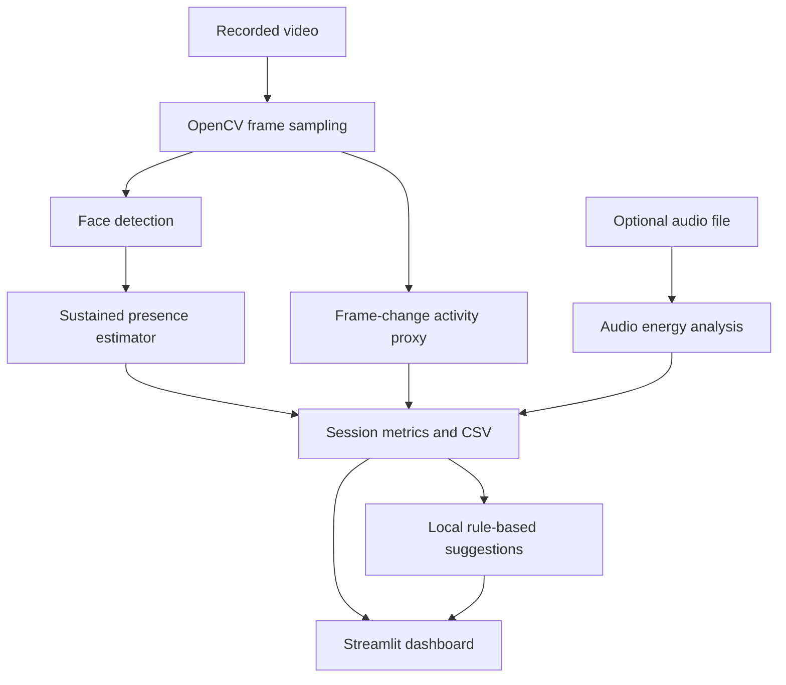

# MULTIMODEL-ATTENDENCE-ENGAGEMENT-SYSTEM
# Multimodal Attendance & Engagement Agent

An **offline-first classroom analytics prototype** that analyzes recorded classroom video and optional audio to produce session-level attendance-presence logs, engagement indicators, and teaching suggestions.

> **Prototype scope:** This repository is a starting implementation for a SkillWallet/GitHub submission. It does not identify students by name, recognize emotions, or prove that a person is paying attention. Video-based results are anonymous presence estimates; engagement indicators are rough behavioral proxies and must not be used for grading or disciplinary decisions.

## Objectives

- Estimate sustained face presence in a recorded session.
- Produce timestamped, anonymous presence intervals and CSV exports.
- Calculate simple visual activity indicators from sampled frames.
- Analyze optional audio energy to estimate periods of audio activity.
- Combine available visual/audio indicators into session-level summaries.
- Generate transparent, rule-based teaching suggestions locally.
- Keep processing local by default; no cloud API is required.

## Architecture



## Features

- Upload a recorded video (`.mp4`, `.mov`, `.avi`, `.mkv`) and optionally an audio file (`.wav`, `.mp3`, `.m4a`, `.ogg`).
- Sample frames at a configurable interval to keep analysis manageable.
- Detect faces with OpenCV's built-in Haar cascade.
- Estimate sustained presence using a configurable minimum number of observations.
- Compute a frame-difference activity proxy and optional audio RMS energy.
- View session summaries and download CSV reports.
- Run locally without Gemini, external APIs, or a cloud service.

## Important limitations

- The current prototype **does not perform identity recognition**. It estimates face-presence observations and reports anonymous session-level presence; it cannot reliably say which named student attended.
- Haar-cascade face detection can miss faces due to lighting, angle, occlusion, distance, or camera quality.
- Frame difference and audio energy are not direct measures of attention, understanding, or learning.
- Audio activity can include noise; it is not speech transcription or speaker identification.
- Results are advisory only. Obtain informed consent, follow institutional policy, minimize retention, and allow human review.
- For actual attendance by student name, a separate consent-based roster/identity workflow and rigorous testing would be required.

## Requirements

- Python 3.10+
- A computer capable of running OpenCV and Streamlit

## Setup

```bash
git clone <YOUR_GITHUB_REPOSITORY_URL>
cd multimodal-attendance-engagement-agent

python -m venv .venv
# Windows:
.venv\Scripts\activate
# macOS/Linux:
source .venv/bin/activate

pip install -r requirements.txt
streamlit run app/main.py
```

Open the local URL printed by Streamlit (usually `http://localhost:8501`).

## Usage

1. Upload a recorded classroom video.
2. Choose the frame sampling interval and sustained-presence threshold.
3. Optionally upload an audio recording from the same session.
4. Click **Analyze session**.
5. Review the estimates and download the CSV outputs.

The app processes uploaded media in memory and does not intentionally upload it to a server. Avoid using identifiable student recordings unless you have permission.

## Project structure

```text
multimodal-attendance-engagement-agent/
├── app/
│   ├── main.py
│   └── analysis_utils.py
├── data/                 # Reserved for local exports; not tracked
├── tests/
│   └── test_analysis_utils.py
├── requirements.txt
├── .gitignore
└── README.md
```

## Testing

```bash
pip install -r requirements.txt
python -m unittest discover -s tests -v
```

## Suggested future improvements

- Robust multi-object tracking across frames.
- Consent-based student enrollment and identity matching.
- Better pose estimation and calibrated movement metrics.
- Voice activity detection instead of a simple energy threshold.
- Session comparison, class-level trends, and teacher-reviewed feedback.
- Evaluation on representative footage with documented precision/recall and fairness checks.

## Status

**MVP prototype / educational project.** Validate with test footage and document observed limitations before describing it as production-ready.
